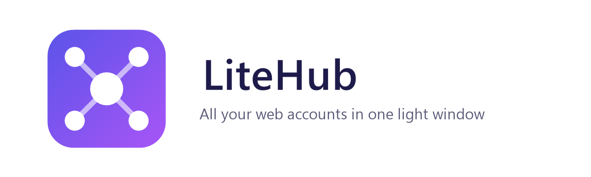
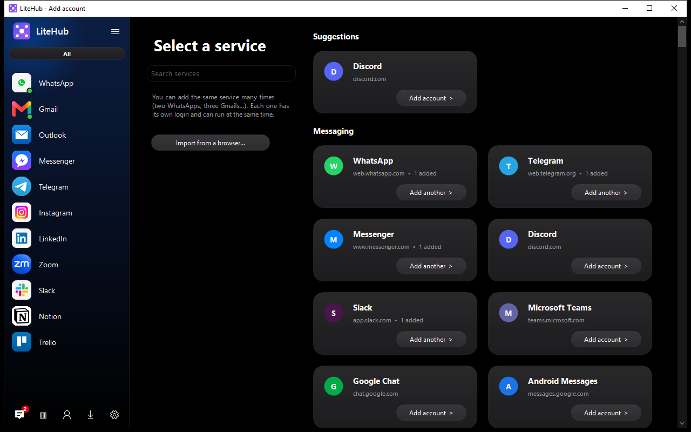
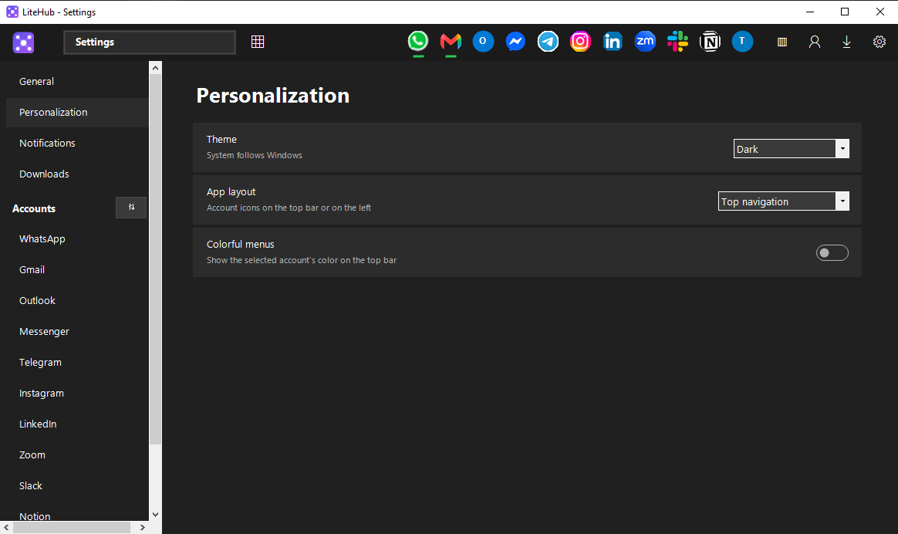

# LiteHub

**All your web accounts in one light window.**
WhatsApp, Telegram, Gmail, Slack, Instagram, LinkedIn and 92 more, each account with its own login,
loaded only when you open it and freed when you stop using it. No ads. No telemetry.



## Why

Apps that put many web apps in one window usually load every account at start-up, so they take seconds to open
and gigabytes of memory. LiteHub is built the other way around:

- **Opens in about a second.** Accounts load when you click them (WhatsApp and Gmail style accounts can stay running for notifications).
- **Light on memory.** Idle accounts are throttled after 1 minute and freed after 5. Close the window and it hides to the tray.
- **Many accounts of the same app.** Two (or ten) WhatsApps, three Gmails: each has its own login, and they can all run at once.
- **Side by side.** Show 2, 3, 4 or 6 accounts in one window (the split button next to the settings).


## Features

- 98 ready services in 11 categories (messaging, meetings, social, email, office and files, productivity, developer, business and ads, AI, music and video, learning) plus any website by address.
- Real platform icons: 77 ship with the program (`assets\services`, made by `LiteHub.exe --fetch-icons assets\services`) so they show instantly and offline; each account re-checks its site once a week, so a new vendor logo replaces ours (a much smaller one never does). accounts of one platform get colored rings so you can tell them apart.
- Windows notifications, unread counts on each icon and on the taskbar button.
- Downloads go to the folder you choose (global or per account), with a list and a "finished" notice.
- Settings: theme (system, light, dark), top or left navigation, per-account color/icon/notifications/download folder, start with Windows, global shortcut (default Alt+E), passcode on launch.
- Close button hides to the tray; running it twice just brings the window back.
- **Import accounts** (Add account, then "Import from a browser..."): picks up the Google accounts of your Chrome profiles and the services found in the bookmarks of Chrome, Edge, Brave, Vivaldi and Opera, or from an exported bookmarks file; one click adds them all. Read locally only; logins cannot be copied from a browser, so you sign in once per account.
- **Notification cards:** alerts appear as LiteHub's own glass cards (account icon, title, text) at the bottom-right, stacked, click to open the account; Settings > Notifications can switch back to plain Windows notifications.
- **Drag and drop to send:** drop files or photos on an account's icon (or on the logo to choose one) and LiteHub opens it and drops them into the page, so an open WhatsApp chat shows its send preview.
- **Workspaces:** group accounts (Work, Personal...) and show one group at a time in the side rail.
- **Unified inbox:** every notification from every account in one list (bell button); click one to open its account. Kept on this PC only, and you can turn that off.
- **Memory meter:** see what each account uses, put it to sleep with one click, or set a memory limit so the least recently used accounts sleep automatically.
- **Do not disturb**, and a **passcode lock per account** (same passcode as the launch lock).
- **Quick switcher** (Ctrl+K), Ctrl+1..9 to jump to an account, Ctrl+Tab to cycle.
- 8 interface languages: English, Arabic, Spanish, French, German, Portuguese, Turkish, Russian (Arabic text is right-to-left; the window layout itself is not mirrored yet).




## Install

1. **Installed:** download `LiteHub-<version>-Setup.exe` from Releases and run it (per user, no admin rights, Start menu entry, removable from Windows Settings).
   **Portable:** download `LiteHub-<version>-portable.zip`, extract it anywhere (a USB stick works) and run `LiteHub.exe`. Everything is kept in the `data` folder next to it, nothing is written to the PC.
   (`LiteHub-<version>-win-x64.zip` is the plain program files without the portable marker.)
2. Silent install for scripts: `LiteHub-<version>-Setup.exe /S` (`/D=C:\folder` to choose the folder, `/NODESKTOP` to skip the desktop shortcut).
3. Needs (Windows 10/11 with the Microsoft Edge WebView2 Runtime, which Windows already has.)
4. The program is not code-signed yet, so Windows SmartScreen may warn the first time: **More info, Run anyway**.

Your accounts, logins and settings live in `%LOCALAPPDATA%\LiteHub` (portable: the `data` folder next to `LiteHub.exe`). Delete that folder to reset everything. Removing an account asks whether to delete its saved login too. If you forget the launch passcode, "Forgot passcode?" removes it and signs you out of every account (the passcode protects those logins, so it cannot be bypassed without losing them).

## Privacy

- No analytics, no accounts, no network calls of its own except fetching each platform's icon from that platform's own site.
- Logins stay on your PC, one separate browser profile per account.
- The inbox keeps notification text (message previews) in `%LOCALAPPDATA%\LiteHub\inbox.txt` unless you turn "Remember inbox" off; locked accounts store no text.
- "Check for updates" only runs when you click it, and only if `UpdateUrl=` (a GitHub "latest release" API address) is set in `settings.txt`.
- The passcode is stored as a salted PBKDF2 hash, never in clear text.
- It does not read your messages; the web apps run exactly as in a normal browser.
- The web engine is Microsoft's Edge WebView2, which follows your Windows diagnostic-data settings; LiteHub itself sends nothing.

## Build

```
build.bat
bin\LiteHub.exe --selftest      (exit code 0 = built-in checks pass)
powershell -File tools\release.ps1   (makes the zip and the Setup exe in dist\)
```

Needs only what ships with Windows (the .NET Framework C# compiler); the WebView2 DLLs are in `lib\`.
Logo files are generated by `tools\make-logo.ps1`.

| File | What it is |
|------|-----------|
| `Program.cs` | main window, tray, hotkey, split view, downloads, taskbar badge |
| `Panels.cs` | settings, add account and downloads screens |
| `Controls.cs` | account icon, toggle, dialogs |
| `Core.cs` | settings, accounts, service catalog, icon fetching, helpers |

## Add a service

Add a line to the list in `Core.cs` (`Catalog.All`): category, name, address, brand color, keep running, open links in browser.
An address like `https://{workspace}.example.com` asks the user for the `{workspace}` part.

## Notes

- Names and logos of other services belong to their owners; LiteHub is not affiliated with them (see THIRD-PARTY-NOTICES.md).
- Some services block or limit unofficial clients, or need their own desktop app (for example Signal, Viber, Line, and video streaming with DRM).

## Author and support

Made by **Ahmed Hussein** ([@Ebnhussein](https://github.com/Ebnhussein)).

- **Bugs, freezes, questions, ideas:** open an issue at https://github.com/Ebnhussein/LiteHub/issues (there is a bug-report template).
  The quickest way: in LiteHub go to *Settings > About > Report a problem*. It copies the diagnostics and opens the issue page; paste them in.
- **Security problems:** please do not open a public issue; email ebnhussein404@gmail.com (see [SECURITY.md](SECURITY.md)).

### Logs and diagnostics

LiteHub keeps a log in `%LOCALAPPDATA%\LiteHub\logs` (10 days, rotated): start-up time, accounts starting and being freed, pages that failed to load,
browser-process crashes, unhandled errors, "window not responding" periods and a memory line every 10 minutes.
It never contains message text or passwords, and accounts appear as `site#number`, so a log is safe to attach to an issue.
*Settings > About* has "Open logs folder" and "Copy diagnostics" (version, Windows build, WebView2 runtime and the last log lines).

MIT license, Copyright (c) 2026 Ahmed Hussein.
