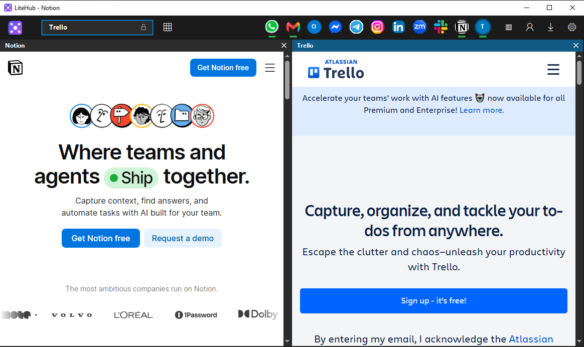

# LiteHub

**All your web accounts in one light window.**
WhatsApp, Telegram, Gmail, Slack, Instagram, LinkedIn and 92 more, each account with its own login,
loaded only when you open it and freed when you stop using it. No ads. No telemetry.


## Why

Apps that put many web apps in one window usually load every account at start-up, so they take seconds to open
and gigabytes of memory. LiteHub is built the other way around:

- **Opens in about a second.** Accounts load when you click them (WhatsApp and Gmail style accounts can stay running for notifications).
- **Light on memory.** Idle accounts are throttled after 1 minute and freed after 5. Close the window and it hides to the tray.
- **Many accounts of the same app.** Two (or ten) WhatsApps, three Gmails: each has its own login, and they can all run at once.
- **Side by side.** Show 2, 3, 4 or 6 accounts in one window (the split button next to the settings).



## Features

- 98 ready services in 11 categories (messaging, meetings, social, email, office and files, productivity, developer, business and ads, AI, music and video, learning) plus any website by address.
- Real platform icons, fetched from the platform's own site; accounts of one platform get colored rings so you can tell them apart.
- Windows notifications, unread counts on each icon and on the taskbar button.
- Downloads go to the folder you choose (global or per account), with a list and a "finished" notice.
- Settings: theme (system, light, dark), top or left navigation, per-account color/icon/notifications/download folder, start with Windows, global shortcut (default Alt+E), passcode on launch.
- Close button hides to the tray; running it twice just brings the window back.


## Install

1. Download the zip from Releases and extract it anywhere.
2. Run `LiteHub.exe`. (Windows 10/11 with the Microsoft Edge WebView2 Runtime, which Windows already has.)
3. The program is not code-signed yet, so Windows SmartScreen may warn the first time: **More info, Run anyway**.

Your accounts, logins and settings live in `%LOCALAPPDATA%\LiteHub`. Delete that folder to reset everything.

## Privacy

- No analytics, no accounts, no network calls of its own except fetching each platform's icon from that platform's own site.
- Logins stay on your PC, one separate browser profile per account.
- The passcode is stored as a salted PBKDF2 hash, never in clear text.
- It does not read your messages; the web apps run exactly as in a normal browser.
- The web engine is Microsoft's Edge WebView2, which follows your Windows diagnostic-data settings; LiteHub itself sends nothing.

## Build

```
build.bat
bin\LiteHub.exe --selftest      (exit code 0 = built-in checks pass)
powershell -File tools\release.ps1   (makes dist\LiteHub-<version>-win-x64.zip)
```

Needs only what ships with Windows (the .NET Framework C# compiler); the WebView2 DLLs are in `lib\`.
Logo files are generated by `tools\make-logo.ps1`.

| File | What it is |
|------|-----------|
| `Program.cs` | main window, tray, hotkey, split view, downloads, taskbar badge |
| `Panels.cs` | settings, add account and downloads screens |
| `Controls.cs` | account icon, toggle, dialogs |
| `Core.cs` | settings, accounts, service catalog, icon fetching, helpers |

## Add a service

Add a line to the list in `Core.cs` (`Catalog.All`): category, name, address, brand color, keep running, open links in browser.
An address like `https://{workspace}.example.com` asks the user for the `{workspace}` part.

## Notes

- Names and logos of other services belong to their owners; LiteHub is not affiliated with them (see THIRD-PARTY-NOTICES.md).
- Some services block or limit unofficial clients, or need their own desktop app (for example Signal, Viber, Line, and video streaming with DRM).
- Check that the name "LiteHub" is free for your use before publishing a product under it.

MIT license.
